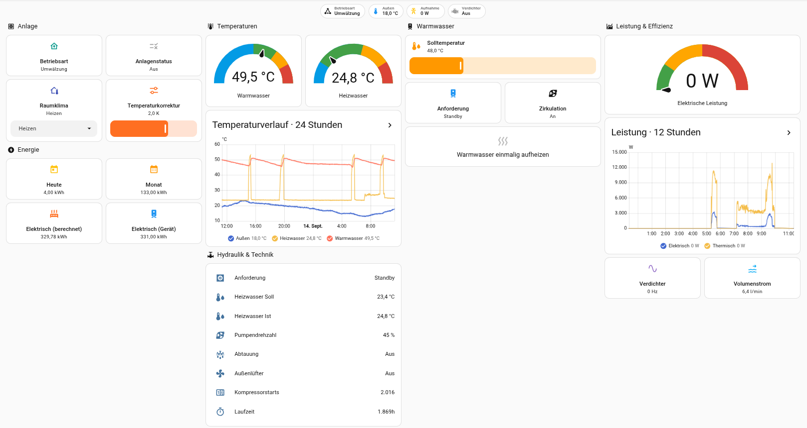

# Home Assistant integration for REMKO heat pumps

[](https://github.com/fuchsi585/remko_http/releases)
[](https://www.hacs.xyz/)
[](https://github.com/fuchsi585/remko_http/actions/workflows/validate.yml)
[](https://github.com/fuchsi585/remko_http/actions/workflows/tests.yml)
[](https://github.com/fuchsi585/remko_http/blob/main/LICENSE)

Home Assistant custom integration for REMKO heat pumps using the local HTTP/CGI interface. No MQTT broker or cloud connection is required.

> 🇩🇪 Deutsch: [README.md](README.md)

## Features

- Configuration through the Home Assistant UI
- Operating, temperature, power, and energy sensors
- Expansion valve opening, refrigerant temperature, and register temperature
- Control of the domestic hot water target temperature, temperature offset, and room climate mode
- One-time domestic hot water heating
- Electrical energy calculation based on measured power consumption

## Supported devices

| Device | Firmware | Status |
|---|---|---|
| WKF120 | 4.25 | Tested |
| WKF70 | 4.24 | Tested |

Other models and firmware versions have not been tested. Available parameters
and their REMKO IDs may differ by model and firmware.

## Requirements

- Home Assistant 2024.1.0 or newer
- REMKO heat pump with an accessible local HTTP/CGI interface
- Network connectivity between Home Assistant and the heat pump
- One heat pump per Home Assistant instance

A static IP address or DHCP reservation is recommended.

> [!IMPORTANT]
> The CGI interface does not require authentication on supported devices.
> It should only be reachable from a trusted local network and must not be
> exposed directly to the internet.

## Installation

### HACS

[](https://my.home-assistant.io/redirect/hacs_repository/?owner=fuchsi585&repository=remko_http&category=integration)

Alternatively, add the repository manually:

1. Open HACS in Home Assistant.
2. Go to **Integrations**.
3. Open **⋮ → Custom repositories**.
4. Add [fuchsi585/remko_http](https://github.com/fuchsi585/remko_http) as a repository of type **Integration**.
5. Install **REMKO HTTP**.
6. Restart Home Assistant.

### Manual

1. Download the [latest release](https://github.com/fuchsi585/remko_http/releases).
2. Copy the `custom_components/remko_http` folder to `config/custom_components/`.
3. Restart Home Assistant.

## Configuration

1. Open **Settings → Devices & services → Add integration**.
2. Search for **REMKO HTTP**.
3. Enter the heat pump's local IP address and the polling interval.

The polling interval defaults to **20 seconds** and can be set between 10 and
60 seconds. The IP address and polling interval can be changed later through
the integration options.

## Dashboard

The [Lovelace template](docs/remko_dashboard.yaml) displays operating data,
history charts, and controls using built-in Home Assistant cards. No additional
HACS cards are required.



Copy the template into a dashboard's raw configuration editor and adjust the
entity IDs to match your installation.
See the [dashboard documentation](docs/dashboard.md) for setup instructions.

## Entities

The tables list the integration's display names and internal keys.
The REMKO ID identifies the parameter used by the HTTP/CGI interface.
Not every model and firmware version supports every value.

### Sensors

| Display name | Internal key | REMKO ID | Unit / value type |
|---|---|---:|---|
| Auxiliary heat generator: Mains voltage | `auxiliary_heat_generator_mains_voltage` | `5796` | V |
| Calculated energy | `energy_electrical` | `5105` | kWh |
| Compressor starts | `compressor_starts` | `5822` | – |
| Current operating mode | `operating_status` | `5001` | Enumerated |
| DHW: Circulation demand | `hot_water_circulation_demand` | `5133` | Enumerated |
| DHW: Circulation pump | `circulation_pump_state` | `5151` | On/off |
| DHW: Circulation target temp. | `hot_water_circulation_target_temperature` | `5041` | °C |
| DHW: Circulation temperature | `circulation_temp` | `5027` | °C |
| DHW: Heating energy | `hot_water_energy` | `5376` | kWh |
| DHW: hygiene function | `hot_water_hygiene_function` | `5803` | Enumerated |
| DHW: Switch valve | `hot_water_diverter_valve` | `5162` | On/off |
| DHW: Tank target temp. | `hot_water_target_temperature` | `5038` | °C |
| Electrical energy (day) | `energy_electrical_day` | `5293` | kWh |
| Electrical energy (Device) | `energy_electrical_raw` | `5105` | kWh |
| Electrical energy (hour) | `energy_electrical_hour` | `5388` | kWh |
| Electrical energy (hour, temporary) | `energy_electrical_hour_temporary` | `5389` | kWh |
| Electrical energy (month) | `energy_electrical_month` | `5295` | kWh |
| Electrical energy (week) | `energy_electrical_week` | `5294` | kWh |
| Electrical energy (year) | `energy_electrical_year` | `5296` | kWh |
| Fan state (outdoor) | `fan_state` | `5135` | On/off |
| Heating water target temperature | `heating_req_temp` | `5085` | °C |
| Heating water temperature | `heating_actual_temp` | `5190` | °C |
| Hot water request | `hot_water_req_state` | `5064` | Enumerated |
| Hot water target temperature | `water_temp_req` | `1082` | °C |
| Hot water temperature | `water_temp` | `5039` | °C |
| HP: 4-way valve | `heat_pump_four_way_valve` | `5136` | On/off |
| HP: Blocking signal | `heat_pump_lock_signal` | `5174` | Enumerated |
| HP: Compressor cut-off | `heat_pump_compressor_lock` | `5005` | On/off |
| HP: Compressor frequency | `heat_pump_compressor_frequency` | `5205` | Hz |
| HP: Compressor status | `heat_pump_compressor_status` | `5625` | On/off |
| HP: Current draw | `heat_pump_current` | `5138` | A |
| HP: Defrost status | `heat_pump_defrost_status` | `5626` | On/off |
| HP: Discharge pipe temp. | `heat_pump_hot_gas_temperature` | `5146` | °C |
| HP: Error status | `heat_pump_error_status` | `5002` | On/off |
| HP: Mode | `heat_pump_mode` | `5006` | Enumerated |
| HP: Opening expansion valve | `heat_pump_expansion_valve_opening` | `5615` | % |
| HP: Operating state | `heat_pump_sub_status` | `5473` | Enumerated |
| HP: Refrigerant temperature | `heat_pump_refrigerant_temperature` | `5139` | °C |
| HP: Register temperature | `heat_pump_register_temperature` | `5200` | °C |
| HP: Release signal | `heat_pump_enable_signal` | `5004` | On/off |
| HP: Remaining blocking time | `heat_pump_lockout_time` | `5572` | min |
| HP: Runtime (minutes) | `heat_pump_runtime_minutes` | `5823` | min |
| HP: Status | `heat_pump_status` | `5049` | Enumerated |
| Hydraulics: Actual flow rate | `hydraulics_actual_flow_rate` | `5582` | l/min |
| Hydraulics: Cooling energy | `hydraulics_cooling_energy` | `5010` | kWh |
| Hydraulics: Heating energy | `hydraulics_heating_energy` | `5374` | kWh |
| Hydraulics: Mixed actual flow rate | `hydraulics_actual_flow_rate_mixed` | `5740` | l/min |
| Hydraulics: Mixed flow temperature | `mixed_flow_temp` | `5741` | °C |
| Hydraulics: Mixed return temperature | `mixed_return_temp` | `5476` / `5581` | °C |
| Hydraulics: Pump speed rel. | `hydraulics_pump_speed` | `5575` | % |
| Hydraulics: Requirement | `hydraulics_demand` | `5040` | Enumerated |
| Hydraulics: Switch valve cooling | `hydraulics_cooling_diverter_valve` | `5166` | On/off |
| Hydraulics: Target volume flow | `hydraulics_target_flow_rate` | `5073` | l/min |
| Hydraulics: Thermal output | `hydraulics_thermal_power` | `5232` | W |
| Mixed outdoor temperature | `mixed_temp` | `5055` | °C |
| Outdoor temperature | `out_temp` | `5032` | °C |
| Power | `power` | `5320` | W |
| Pump speed (heating circuit) | `pump_speed` | `5576` | % |
| Room climate mode | `room_climate_mode` | `1088` | Enumerated |
| Room humidity | `room_humidity` | `5066` | % |
| Room target temperature | `room_temp_req` | `5075` | °C |
| Room temperature | `room_temp_act` | `5050` | °C |
| Runtime | `runtime_hours` | `5824` | h |
| Thermal power | `power_thermal` | `5321` | W |
| Unmixed HC: Actual temperature | `heating_circuit_unmixed_actual_temperature` | `5034` | °C |
| Unmixed HC: Dew point | `heating_circuit_unmixed_dew_point` | `5070` | °C |
| Unmixed HC: Operating mode | `heating_circuit_unmixed_operating_mode` | `5069` | Enumerated |
| Unmixed HC: Setpoint adjustment | `heating_circuit_unmixed_setpoint_adjustment` | `5717` | °C |
| Unmixed HC: Status | `heating_circuit_unmixed_status` | `5710` | Enumerated |
| Unmixed HC: Target temperature | `heating_circuit_unmixed_target_temperature` | `5033` | °C |
| Warmer / cooler | `cold_hotter_state` | `1946` | K |

- For `mixed_return_temp`, the WKF 70 (F) uses ID `5581`; other models use `5476`.
- The hot water target temperature sensor and the direct device counter
  `energy_electrical_raw` are disabled by default and can be enabled as needed.
- Current draw, mains voltage, and the temporary hourly energy value are marked
  as diagnostic. The temporary hourly value has four decimal places.

### Controls

| Display name | Internal key | REMKO ID | Function |
|---|---|---:|---|
| 1 x DHW heating | `action_heat_warm_water` | `5693` | Start one-time domestic hot water heating |
| Warmer / cooler | `set_cold_hotter` | `1946` | Temperature offset from 0 to 3 K in 0.5 K steps |
| Room climate mode | `set_room_climate_mode` | `1088` | Auto, heating, standby, or cooling |
| Hot water target temperature | `set_water_temp_req` | `1082` | Target from 35 to 80 °C in 0.5 °C steps |

The one-time heating button requires valid data and a domestic hot water request
state of **Standby**. Temperature availability uses a 0.5 °C hysteresis band:
reaching the target disables the button; it becomes available again once the
temperature falls 0.5 °C below the target. On startup, any temperature below
the target is sufficient. An active hot water request also resets availability.
`Unknown` is normal for a button that has not been pressed; `Unavailable`
indicates a blocked action or missing data.

### Electrical energy calculation

**Calculated energy** (`energy_electrical`) is derived from electrical power
(`5320`). The device counter `5105` provides the initial and reference values.
The trapezoidal rule is applied between successful updates:

```text
additional energy [kWh]
  = (previous power [W] + current power [W]) / 2
    × time difference [h] / 1000
```

If power readings are missing, the counter is retained. Gaps exceeding four
times the polling interval are not filled during normal operation.

Counter readings are saved on the first valid update, then every three polling
intervals and on normal shutdown. At the default interval, this is every
60 seconds. After a restart, a plausible change in the device counter since
the last save is added once. Because the device counter advances in 1 kWh
steps, unsaved consumption may be lost after an unexpected restart.
The direct device counter is available separately as **Electrical energy
(Device)**.

## Troubleshooting

- **No connection:** Check power, the configured IP address, access to the local
  web interface, and firewall or VLAN rules.
- **Missing or unavailable values:** Compare the model and firmware with the
  supported devices and check the Home Assistant logs. Individual parameters
  may depend on the model.
- **Hot water button unavailable:** Check the hot water request state, actual
  and target temperatures, and the hysteresis described above.

When opening an [issue](https://github.com/fuchsi585/remko_http/issues), include
the model, firmware version, and relevant log messages.

## Contributing

[Discussions](https://github.com/fuchsi585/remko_http/discussions) and
[pull requests](https://github.com/fuchsi585/remko_http/pulls) are welcome.

## Acknowledgements

Thanks to **Altrec**, **jovana**, and the Home Assistant community for their
groundwork and shared experience.

## Disclaimer

This project is not affiliated with or officially supported by REMKO.
Use this integration at your own risk.

## License and author

[MIT License](LICENSE) · Developed by [fuchsi585](https://github.com/fuchsi585).
