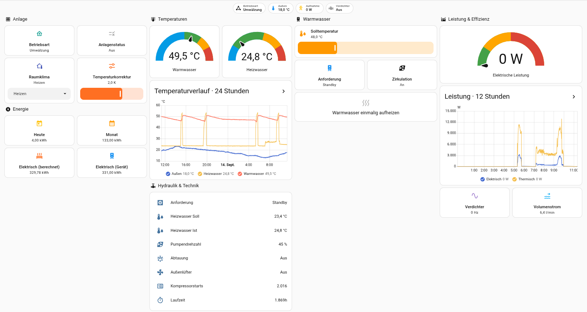

# Home Assistant Integration für REMKO Wärmepumpen

[](https://github.com/fuchsi585/remko_http/releases)
[](https://www.hacs.xyz/)
[](https://github.com/fuchsi585/remko_http/actions/workflows/validate.yml)
[](https://github.com/fuchsi585/remko_http/actions/workflows/tests.yml)
[](https://github.com/fuchsi585/remko_http/blob/main/LICENSE)

Home Assistant Custom Integration für REMKO Wärmepumpen mit lokaler HTTP-/CGI-Schnittstelle. Kein MQTT-Broker und keine Cloud-Verbindung erforderlich.

> 🇬🇧 English: [README.en.md](README.en.md)

## Funktionen

- Einrichtung über die Home-Assistant-Oberfläche
- Betriebs-, Temperatur-, Leistungs- und Energiewerte als Sensoren
- Öffnungsgrad des Expansionsventils, Kältemittel- und Registertemperatur
- Steuerung von Warmwasser-Solltemperatur, Temperaturanpassung und Raumklimamodus
- Einmaliges Aufheizen des Warmwassers
- Berechnung des elektrischen Energieverbrauchs aus der gemessenen Leistung

## Unterstützte Geräte

| Gerät | Firmware | Status |
|---|---|---|
| WKF120 | 4.25 | Getestet |
| WKF70 | 4.24 | Getestet |

Andere Modelle und Firmware-Versionen sind nicht getestet. Die verfügbaren
Parameter und deren REMKO-IDs können je nach Modell und Firmware abweichen.

## Voraussetzungen

- Home Assistant 2024.1.0 oder neuer
- REMKO Wärmepumpe mit erreichbarer lokaler HTTP-/CGI-Schnittstelle
- Netzwerkverbindung zwischen Home Assistant und Wärmepumpe
- Eine Wärmepumpe pro Home-Assistant-Instanz

Eine feste IP-Adresse bzw. DHCP-Reservierung wird empfohlen.

> [!IMPORTANT]
> Die CGI-Schnittstelle benötigt bei unterstützten Geräten keine Anmeldung.
> Sie sollte nur aus einem vertrauenswürdigen lokalen Netzwerk erreichbar sein
> und nicht direkt ins Internet freigegeben werden.

## Installation

### HACS

[](https://my.home-assistant.io/redirect/hacs_repository/?owner=fuchsi585&repository=remko_http&category=integration)

Alternativ das Repository manuell hinzufügen:

1. HACS in Home Assistant öffnen.
2. Zu **Integrationen** wechseln.
3. **⋮ → Benutzerdefinierte Repositories** öffnen.
4. [fuchsi585/remko_http](https://github.com/fuchsi585/remko_http) als Repository vom Typ **Integration** hinzufügen.
5. **REMKO HTTP** installieren.
6. Home Assistant neu starten.

### Manuell

1. Die [neueste Version](https://github.com/fuchsi585/remko_http/releases) herunterladen.
2. Den Ordner `custom_components/remko_http` nach `config/custom_components/` kopieren.
3. Home Assistant neu starten.

## Konfiguration

1. **Einstellungen → Geräte & Dienste → Integration hinzufügen** öffnen.
2. Nach **REMKO HTTP** suchen.
3. Die lokale IP-Adresse der Wärmepumpe und das Abfrageintervall eingeben.

Das Abfrageintervall beträgt standardmäßig **20 Sekunden** und kann zwischen
10 und 60 Sekunden eingestellt werden. IP-Adresse und Abfrageintervall lassen
sich später über die Optionen der Integration ändern.

## Dashboard

Die [Lovelace-Vorlage](docs/remko_dashboard.yaml) zeigt Betriebswerte, Verläufe und
Steuerelemente mit Home-Assistant-Bordmitteln. Zusätzliche HACS-Karten sind nicht
erforderlich.



Den Inhalt der Vorlage in den Raw-Konfigurationseditor eines Dashboards kopieren
und die Entitäts-IDs an die eigene Installation anpassen.
Eine Anleitung steht in der [Dashboard-Dokumentation](docs/dashboard.md).

## Entitäten

Die Tabellen nennen die Anzeigenamen und internen Keys der Integration.
Die REMKO-ID bezeichnet den Parameter der HTTP-/CGI-Schnittstelle.
Nicht jeder Wert wird von jedem Modell und jeder Firmware unterstützt.

### Sensoren

| Anzeigename | Interner Key | REMKO-ID | Einheit / Werteart |
|---|---|---:|---|
| Aktuelle Betriebsart | `operating_status` | `5001` | Auswahlwert |
| Außentemperatur | `out_temp` | `5032` | °C |
| Elektr. Energie | `energy_electrical` | `5105` | kWh |
| Elektr. Energie (Gerät) | `energy_electrical_raw` | `5105` | kWh |
| Elektr. Energie (Jahr) | `energy_electrical_year` | `5296` | kWh |
| Elektr. Energie (Monat) | `energy_electrical_month` | `5295` | kWh |
| Elektr. Energie (Stunde) | `energy_electrical_hour` | `5388` | kWh |
| Elektr. Energie (Stunde, temporär) | `energy_electrical_hour_temporary` | `5389` | kWh |
| Elektr. Energie (Tag) | `energy_electrical_day` | `5293` | kWh |
| Elektr. Energie (Woche) | `energy_electrical_week` | `5294` | kWh |
| Gemischte Außentemperatur | `mixed_temp` | `5055` | °C |
| Heizwasser Isttemperatur | `heating_actual_temp` | `5190` | °C |
| Heizwasser Solltemperatur | `heating_req_temp` | `5085` | °C |
| HK ungemischt: Betriebsmodus | `heating_circuit_unmixed_operating_mode` | `5069` | Auswahlwert |
| HK ungemischt: Ist-Temperatur | `heating_circuit_unmixed_actual_temperature` | `5034` | °C |
| HK ungemischt: Soll-Temperatur | `heating_circuit_unmixed_target_temperature` | `5033` | °C |
| HK ungemischt: Sollwertanpassung | `heating_circuit_unmixed_setpoint_adjustment` | `5717` | °C |
| HK ungemischt: Status | `heating_circuit_unmixed_status` | `5710` | Auswahlwert |
| HK ungemischt: Taupunkt | `heating_circuit_unmixed_dew_point` | `5070` | °C |
| Hydraulik: Anforderung | `hydraulics_demand` | `5040` | Auswahlwert |
| Hydraulik: Energie Heizen | `hydraulics_heating_energy` | `5374` | kWh |
| Hydraulik: Energie Kühlen | `hydraulics_cooling_energy` | `5010` | kWh |
| Hydraulik: Ist-Volumenstrom | `hydraulics_actual_flow_rate` | `5582` | l/min |
| Hydraulik: Ist-Volumenstrom (gemischt) | `hydraulics_actual_flow_rate_mixed` | `5740` | l/min |
| Hydraulik: Leistung therm. | `hydraulics_thermal_power` | `5232` | W |
| Hydraulik: Pumpendrehz. rel. | `hydraulics_pump_speed` | `5575` | % |
| Hydraulik: Rücklauftemperatur (gemischt) | `mixed_return_temp` | `5476` / `5581` | °C |
| Hydraulik: Soll-Volumenstrom | `hydraulics_target_flow_rate` | `5073` | l/min |
| Hydraulik: Umschaltventil Kühlen | `hydraulics_cooling_diverter_valve` | `5166` | An/Aus |
| Hydraulik: Vorlauftemperatur (gemischt) | `mixed_flow_temp` | `5741` | °C |
| Kompressorstarts | `compressor_starts` | `5822` | – |
| Kälter / Wärmer | `cold_hotter_state` | `1946` | K |
| Laufzeit | `runtime_hours` | `5824` | h |
| Leistung | `power` | `5320` | W |
| Lüfterstatus (außen) | `fan_state` | `5135` | An/Aus |
| Pumpendrehzahl (Heizkreis) | `pump_speed` | `5576` | % |
| Raum Isttemperatur | `room_temp_act` | `5050` | °C |
| Raum Solltemperatur | `room_temp_req` | `5075` | °C |
| Raumfeuchtigkeit | `room_humidity` | `5066` | % |
| Raumklima-Modus | `room_climate_mode` | `1088` | Auswahlwert |
| Thermische Leistung | `power_thermal` | `5321` | W |
| Warmwasseranforderung | `hot_water_req_state` | `5064` | Auswahlwert |
| Wassertank Isttemperatur | `water_temp` | `5039` | °C |
| Wassertank Solltemperatur | `water_temp_req` | `1082` | °C |
| WP: 4-Wege Ventil | `heat_pump_four_way_valve` | `5136` | An/Aus |
| WP: Abtaustatus | `heat_pump_defrost_status` | `5626` | An/Aus |
| WP: Betriebszustand | `heat_pump_sub_status` | `5473` | Auswahlwert |
| WP: Fehlerstatus | `heat_pump_error_status` | `5002` | An/Aus |
| WP: Freigabesignal | `heat_pump_enable_signal` | `5004` | An/Aus |
| WP: Heißgastemperatur | `heat_pump_hot_gas_temperature` | `5146` | °C |
| WP: Kompressorstatus | `heat_pump_compressor_status` | `5625` | An/Aus |
| WP: Kältemitteltemperatur | `heat_pump_refrigerant_temperature` | `5139` | °C |
| WP: Laufzeit (Minuten) | `heat_pump_runtime_minutes` | `5823` | min |
| WP: Modus | `heat_pump_mode` | `5006` | Auswahlwert |
| WP: Registertemperatur | `heat_pump_register_temperature` | `5200` | °C |
| WP: Sperrsignal | `heat_pump_lock_signal` | `5174` | Auswahlwert |
| WP: Status | `heat_pump_status` | `5049` | Auswahlwert |
| WP: Stromaufnahme | `heat_pump_current` | `5138` | A |
| WP: Verbleibende Sperrzeit | `heat_pump_lockout_time` | `5572` | min |
| WP: Verdichterfrequenz | `heat_pump_compressor_frequency` | `5205` | Hz |
| WP: Verdichtersperre | `heat_pump_compressor_lock` | `5005` | An/Aus |
| WP: Öffnungsgrad Expansionsventil | `heat_pump_expansion_valve_opening` | `5615` | % |
| WW: Anforderung Zirkulation | `hot_water_circulation_demand` | `5133` | Auswahlwert |
| WW: Energie | `hot_water_energy` | `5376` | kWh |
| WW: Hygienefunktion | `hot_water_hygiene_function` | `5803` | Auswahlwert |
| WW: Speicher Soll-Temp. | `hot_water_target_temperature` | `5038` | °C |
| WW: Umschaltventil | `hot_water_diverter_valve` | `5162` | An/Aus |
| WW: Zirk. Soll-Temp. | `hot_water_circulation_target_temperature` | `5041` | °C |
| WW: Zirkulationspumpe | `circulation_pump_state` | `5151` | An/Aus |
| WW: Zirkulationstemperatur | `circulation_temp` | `5027` | °C |
| Zusatz-Wärmeerzeuger: Netzspannung | `auxiliary_heat_generator_mains_voltage` | `5796` | V |

- Für `mixed_return_temp` wird bei der WKF 70 (F) ID `5581` verwendet, sonst `5476`.
- Der Wassertank-Sollwertsensor und der direkte Gerätezähler `energy_electrical_raw`
  sind standardmäßig deaktiviert und können bei Bedarf aktiviert werden.
- Stromaufnahme, Netzspannung und der temporäre Stundenenergiewert sind als
  Diagnosewerte markiert. Der temporäre Stundenwert hat vier Nachkommastellen.

### Steuerung

| Anzeigename | Interner Key | REMKO-ID | Funktion |
|---|---|---:|---|
| 1 x WW aufheizen | `action_heat_warm_water` | `5693` | Einmaliges Aufheizen starten |
| Kälter / Wärmer | `set_cold_hotter` | `1946` | Temperaturanpassung von 0 bis 3 K in Schritten von 0,5 K |
| Raumklima-Modus | `set_room_climate_mode` | `1088` | Auto, Heizen, Standby oder Kühlen |
| Wassertank Solltemperatur | `set_water_temp_req` | `1082` | Sollwert von 35 bis 80 °C in Schritten von 0,5 °C |

Der Button zum einmaligen Aufheizen ist nur bei gültigen Daten und
Warmwasseranforderung **Standby** verfügbar. Die Temperaturfreigabe verwendet
eine Hysterese von 0,5 °C: Bei Erreichen der Solltemperatur wird gesperrt,
erneut freigegeben wird erst 0,5 °C darunter. Beim Start genügt eine Temperatur
unterhalb des Sollwerts. Eine aktive Warmwasseranforderung setzt die Freigabe
ebenfalls zurück. `Unbekannt` ist bei einem noch nicht gedrückten Button normal;
`Nicht verfügbar` kennzeichnet eine Sperre oder fehlende Daten.

### Berechnung der elektrischen Energie

**Elektr. Energie** (`energy_electrical`) wird aus der elektrischen Leistung
(`5320`) berechnet. Der Gerätezähler `5105` dient als Start- und Referenzwert.
Zwischen zwei erfolgreichen Abfragen gilt die Trapezregel:

```text
zusätzliche Energie [kWh]
  = (vorherige Leistung [W] + aktuelle Leistung [W]) / 2
    × Zeitdifferenz [h] / 1000
```

Bei fehlenden Leistungswerten bleibt der Zähler erhalten. Datenlücken über dem
Vierfachen des Abfrageintervalls werden im laufenden Betrieb nicht nachgetragen.

Die Zählerstände werden beim ersten gültigen Abruf, danach alle drei
Abfrageintervalle und beim regulären Beenden gespeichert. Beim Standardintervall
sind das alle 60 Sekunden. Nach einem Neustart wird eine plausible Differenz des
Gerätezählers seit der Speicherung einmalig ergänzt. Wegen dessen
1-kWh-Auflösung kann nach einem unerwarteten Neustart ungespeicherter Verbrauch
fehlen. Der direkte Gerätezähler ist separat als **Elektr. Energie (Gerät)**
verfügbar.

## Fehlerbehebung

- **Keine Verbindung:** Stromversorgung, konfigurierte IP-Adresse, Erreichbarkeit
  der lokalen Weboberfläche sowie Firewall- und VLAN-Regeln prüfen.
- **Fehlende oder nicht verfügbare Werte:** Modell und Firmware mit den
  unterstützten Geräten abgleichen und die Home-Assistant-Protokolle prüfen.
  Einzelne Parameter können modellabhängig sein.
- **Warmwasserbutton nicht verfügbar:** Warmwasseranforderung, Ist- und
  Solltemperatur sowie die oben beschriebene Hysterese prüfen.

Bei einem [Issue](https://github.com/fuchsi585/remko_http/issues) Modell,
Firmware-Version und relevante Protokollmeldungen angeben.

## Mitwirken

[Diskussionen](https://github.com/fuchsi585/remko_http/discussions) und
[Pull Requests](https://github.com/fuchsi585/remko_http/pulls) sind willkommen.

## Danksagung

Vielen Dank an **Altrec**, **jovana** und die Home-Assistant-Community für
Vorarbeit und Erfahrungsaustausch.

## Haftungsausschluss

Dieses Projekt ist nicht offiziell mit REMKO verbunden und wird nicht von REMKO
unterstützt. Die Verwendung erfolgt auf eigene Verantwortung.

## Lizenz und Autor

[MIT License](LICENSE) · Entwickelt von [fuchsi585](https://github.com/fuchsi585).
